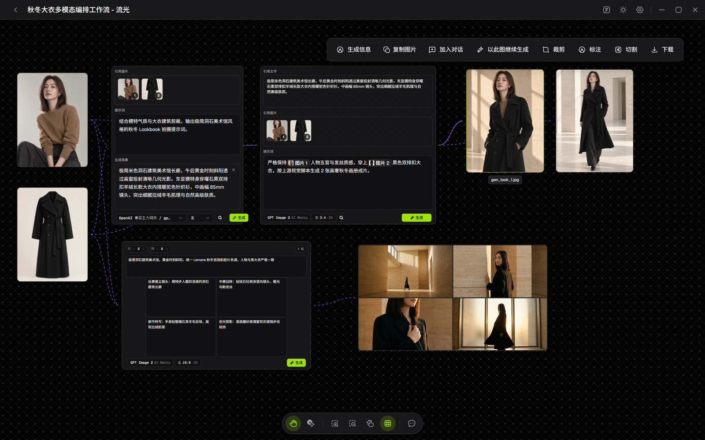
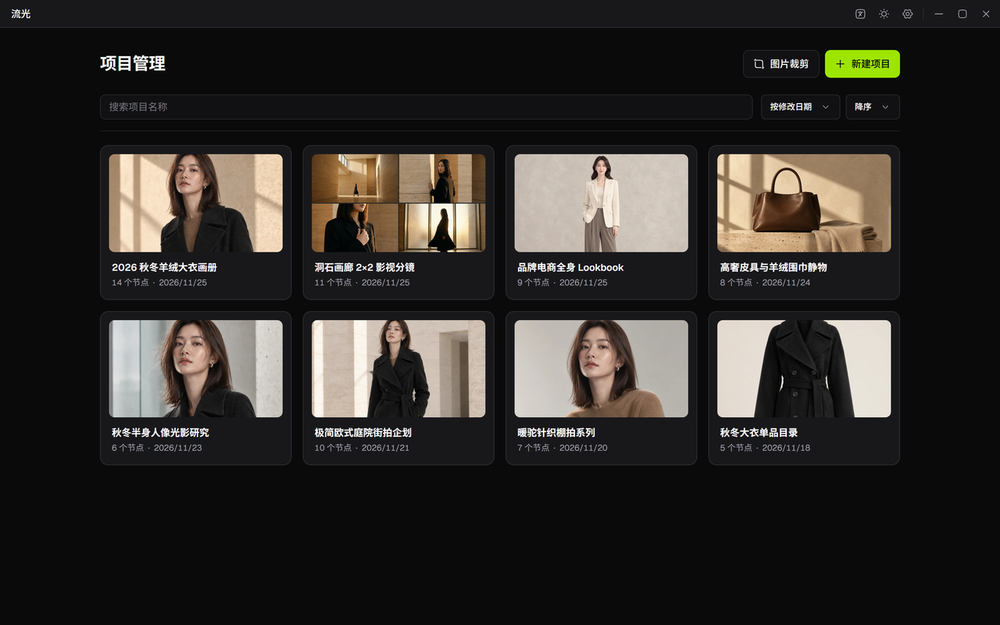

<div align="center">
  
  <h1>Lumina</h1>
  <p><strong>A desktop node-canvas studio for AI visual creation</strong></p>
  <p>Combining an infinite node canvas, built-in &amp; external MCP canvas agents, multimodal image &amp; storyboard workflows, Seedance video generation, and a batch image crop &amp; AI fill workbench.</p>

  <p>
    <a href="./README.md">简体中文</a> · <strong>English</strong>
  </p>

  <p>
    <a href="https://github.com/mailwmj/Lumina/releases/latest">
      
    </a>
    
    
    <a href="./LICENSE">
      
    </a>
  </p>

  <p>
    <a href="https://github.com/mailwmj/Lumina/releases/latest">Download</a> ·
    <a href="#features--interface-tour">Features &amp; UI</a> ·
    <a href="#external-agent-integration-mcp">External Agent MCP</a> ·
    <a href="#download--quick-start">Quick Start</a> ·
    <a href="#local-development--extending">Development</a>
  </p>

  <br />

  
</div>

---

## Why Lumina?

Most web-based AI tools trap creative work inside a single linear chat thread: reference images scatter, prompts are hard to reuse, and variations disappear as soon as you scroll. **Lumina** brings the entire visual production workflow onto a native desktop **infinite node canvas**:

- **Visual node graph instead of one-off prompts**: Connect reference media, text reasoning, image generation, storyboard grids, and video nodes on one persistent canvas. Every result tracks its provenance, records full generation parameters, and restores back to its upstream node in one click.
- **Two-way canvas &amp; Agent collaboration**: Work conversationally with the **built-in Canvas Agent** docked beside your canvas—or connect external MCP agents like Codex through Lumina's bundled native **MCP companion**, with atomic validation and **single-step batch undo**.
- **From concept exploration to production delivery**: Edit assets in place with built-in crop, annotation, and storyboard splitting tools, plus a dedicated **Batch Image Crop &amp; Fixed Canvas workbench** with directional region stretch and AI fill for e-commerce and lookbook delivery.
- **Native desktop speed + open BYOK ecosystem**: Built with Tauri 2, Rust, and local SQLite (WAL). Your projects and API keys stay local while connecting freely to OpenAI Images–compatible, Gemini native, OpenAI-compatible text, and Seedance video endpoints.

---

## Features & Interface Tour

### 1. Infinite Node Canvas & Multimodal Orchestration

A compact, tool-first desktop canvas built for high-density visual work: drag-and-drop node creation, typed connection validation, multi-select batch connect, spline / orthogonal / smart-avoidance edge routing, grid snapping, minimap, and full batch undo/redo.

<div align="center">
  
</div>

- **AI Image Generation &amp; Editing**: Ordered multi-image references (`Image 1`, `Image 2`, …), `0.5K / 1K / 2K / 4K` resolution tiers, batch `1 / 2 / 4` outputs with automatic stacked layout, generation record inspection (**Restore to source**), and resilient task recovery with manual **Re-query task** (never double-submitting or double-charging).
- **Storyboard Generation &amp; Splitting**: Build `N × M` storyboard grids with global style prompts, cell vs. overall aspect ratio control, style-consistency / no-text / auto-infer switches, and split generated grids into individual editable frames.
- **First-Class Text Nodes &amp; Dedicated Prompt Polishing**: Chain upstream text and up to 10 reference images into a **Text Node** with configurable reasoning effort (`none` to `max`). Configure separate prompt-polishing models and custom templates for image/storyboard/video nodes vs. text nodes.
- **Built-in Canvas Image Tools**: Launch **Crop**, **Annotate**, **Split Storyboard**, and a full-screen **Image Viewer** directly from any image node; outputs spawn as new canvas nodes ready for downstream wiring.

---

### 2. Built-in Canvas Agent Panel

Expand the resizable Agent panel on the right of any canvas to turn natural-language creative direction into structured iterations directly on your graph.

<div align="center">
  
</div>

- **Explicit Canvas Context**: Reference canvas images intentionally via `@`, the node toolbar's **Add to chat**, or drag-and-drop / clipboard paste. Unreferenced nodes are never silently leaked into model context.
- **Interactive Clarification Cards**: When framing, style, or intent is ambiguous, the Agent pauses with structured question cards—pick an option, write a custom answer, click **You decide**, reply directly in chat, or cancel without mutating the canvas.
- **Visual Self-Review &amp; Auto Layout**: With vision- and tool-capable models, the Agent inspects generated outputs and iterates automatically. Repeated generations stack cleanly in rows per conversation while the viewport pans to reveal new results.
- **Multi-Thread Persistence &amp; Traceability**: Keep multiple conversations per project with per-thread model, resolution, and draft memory. Use **View conversation** on any Agent-created result node to jump straight back to the originating turn.

---

### 3. Seedance Multimodal AI Video Workflow

Native support for Volcengine Seedance video pipelines, turning static references and storyboards into motion on the same canvas.

<div align="center">
  
</div>

- **Seedance Model Family**: Supports **Seedance 2.0 / 2.0 Fast** and **Seedance 1.5 Pro**, including **Draft Mode** to preview motion at lower cost before promoting to a final render in one click.
- **Multimodal &amp; First/Last Frame Modes**:
  - **Multimodal mode**: Combine up to **9 reference images + 3 reference videos + 3 reference audio files** alongside upstream text nodes.
  - **First / Last Frame mode**: Lock start and end frames with drag-to-reorder handles.
- **Cinematic Controls**: Built-in presets for camera movement (push-in, pull-out, orbit, follow, pan, tilt, handheld), shot size, camera angle, and motion speed, plus audio output, web search, and safe task re-querying.

---

### 4. Batch Image Crop & Fixed Canvas Workbench

Accessible directly from the home screen, built for e-commerce, lookbook, and apparel retouching workflows that need fast, consistent multi-asset output.

<div align="center">
  
</div>

- **High-Volume Standardized Delivery**: Import up to **100 images** per batch (JPG / JPEG / PNG) with preset e-commerce target dimensions (`1440 × 1440`, `1440 × 1920`, `1440 × 2200`), exporting quality-100 JPGs without overwriting originals.
- **Per-Image Composition Modes**: Toggle each image independently between **Crop to Fill** and **Fixed Canvas** while preserving separate drafts—keep full-body portraits intact when converting vertical shots to square frames.
- **Region Stretch + Parallel AI Fill**:
  - **Region Stretch**: Draw a selection strip over clean backgrounds and pull directional handles to extend into blank space, supporting multiple stretch regions with undo/redo.
  - **AI Fill**: Send the composed fixed canvas to a configured image-editing model to naturally continue complex backgrounds. Displays transparent model/quality/cost confirmation before submitting, runs tasks in parallel in the background while you click **Process Next**, and exports mixed-mode batches together.

---

### 5. Local Project Management, Model Settings & Dual Themes

<div align="center">
  <table>
    <tr>
      <td width="50%" align="center">
        
        <br />
        <sub><b>Local Project Manager</b>: search, sort, node counts, and SQLite auto-persistence</sub>
      </td>
      <td width="50%" align="center">
        
        <br />
        <sub><b>Settings Center</b>: health overview, multi-protocol providers, MCP &amp; themes</sub>
      </td>
    </tr>
  </table>
</div>

- **Local-First Ownership**: Every project, canvas history stack, and Agent thread persists automatically to local SQLite (WAL). Configure up to 8 preset download folders for one-click saving from any node toolbar.
- **Bilingual UI &amp; Visual Customization**: Full English / 简体中文 interface, Dark &amp; Light themes, and customizable accent color with automatic contrast-safe foreground calculation.

---

## External Agent Integration (MCP)

Lumina ships with a bundled native MCP companion (`lumina-canvas-agent`) managed automatically by the desktop app. **End users do not need the source repo, Node.js, or Bun** to connect Codex or any standard MCP client to the active canvas.

```text
Codex / MCP Client ──(stdio MCP)──▶ lumina-canvas-agent ──(127.0.0.1 + Token)──▶ Live Lumina Canvas
```

**Connect Codex in 3 steps:**

1. Open **Settings > Integrations** in Lumina and enable **Allow external Agents to access the active canvas**.
2. Copy the generated registration command and run it once in your terminal:
   ```bash
   codex mcp add lumina -- /path/to/lumina-canvas-agent mcp ...
   ```
3. Start a new Codex session to discover Lumina's canvas tools (import references, create/update/connect nodes, run image generation, poll progress, and inspect compressed result previews).

**Security &amp; Safety Guarantees:**
- Binds strictly to `127.0.0.1` with a high-entropy owner-local bearer token; API credentials, local filesystem paths, and raw SQLite snapshots are never exposed.
- Every write passes an operation whitelist, active-project check, and canvas revision guard as an atomic `CanvasChangeSet`—**one canvas Undo reverts the entire batch**.

> See [External Agent MCP Documentation](./docs/agents/external-agent-mcp.md) for the full tool workflow, protocol details, and dev-mode setup.

---

## Download & Quick Start

### 1. Download the Desktop App

Grab the latest installer from [GitHub Releases](https://github.com/mailwmj/Lumina/releases/latest):

| Platform | Installer | Notes |
| --- | --- | --- |
| **macOS** (Apple Silicon &amp; Intel) | `Lumina_<version>_universal.dmg` | Universal Binary with bundled native MCP companion |
| **Windows** (x64) | `Lumina_<version>_x64-setup.exe` | NSIS installer; if launch fails, install the [WebView2 Runtime](https://developer.microsoft.com/en-us/microsoft-edge/webview2#download) |

### 2. First-Time Setup (3 Steps)

1. **Configure Model Services**: Open **Settings > Model services** from the title bar and add your Image, Text, or Video APIs (use **Fetch models** and **Test connection** to verify immediately).
2. **Check Readiness**: Visit **Settings > Overview** to confirm Image generation, Video generation, and Prompt polishing are all marked **Ready**.
3. **Start Creating**: Click **New Project** to open an infinite canvas (double-click or right-click to add nodes), or open **Image Crop** for batch asset retouching.

### 3. Supported Model Protocols

Lumina follows a **BYOK (Bring Your Own Key)** design so you can connect official endpoints, internal gateways, or compatible third-party services:

| Capability | Supported Protocols / Models | Highlights |
| --- | --- | --- |
| **Image Generation &amp; Editing** | OpenAI Images compatible (`/v1/images/generations`, `/v1/images/edits`), Gemini Native (`/v1beta/models/<model>:generateContent`), and compatible custom image providers | Custom Base URLs, multiple concurrent providers, model discovery, and manual model IDs |
| **Text Nodes / Built-in Agent / Prompt Polish** | OpenAI-compatible Chat Completions text &amp; multimodal APIs | Model discovery, connection testing, vision &amp; tool-calling probes, configurable reasoning effort |
| **Video Generation** | Volcengine Seedance-compatible video endpoints (Seedance 2.0 / 2.0 Fast / Seedance 1.5 Pro) | Multimodal references, first/last frame mode, draft mode, and per-provider polish templates |

---

## Local Development & Extending

### Tech Stack

| Layer | Technologies |
| --- | --- |
| **Frontend** | React 18 · TypeScript · Zustand · `@xyflow/react` · TailwindCSS · Motion · Vercel AI SDK |
| **Desktop &amp; Backend** | Tauri 2 · Rust |
| **Persistence** | SQLite (`rusqlite`, WAL mode) |
| **External Agent Bridge** | TypeScript + Bun (compiled standalone `lumina-canvas-agent` sidecar) |
| **Internationalization** | `react-i18next` + `i18next` (English &amp; Simplified Chinese) |

### Prerequisites

- **Node.js** 20+ and **npm** 10+
- **Rust** stable (with Cargo) and platform [Tauri 2 prerequisites](https://v2.tauri.app/start/prerequisites/)
- **Bun** 1.3+ (only required when compiling the bundled `lumina-canvas-agent` desktop sidecar)

### Run & Build

```bash
# 1. Install frontend and Canvas Agent dependencies
npm install
npm install --prefix canvas-agent

# 2. Run the full Tauri desktop app in dev mode (recommended)
npm run tauri dev

# Or run the Vite frontend only
npm run dev
```

<details>
<summary><strong>Common Verification &amp; Build Commands</strong></summary>

```bash
# TypeScript type check
npx tsc --noEmit

# Run unit tests (frontend & Canvas Agent)
npx vitest run
npm run canvas-agent:test

# Rust backend check
cd src-tauri && cargo check

# Production frontend build
npm run build

# Package desktop installers (macOS .dmg / Windows .exe)
npm run tauri build
```

</details>

<details>
<summary><strong>Core Project Structure</strong></summary>

```text
Lumina/
├── src/
│   ├── features/
│   │   ├── canvas/            # Infinite node canvas (nodes, edges, tool editors, model registry)
│   │   ├── agent/             # Built-in Canvas Agent panel, threads, and tool execution
│   │   ├── canvas-agent/      # Frontend bridge for external MCP agent access
│   │   ├── batch-image-crop/  # Batch image crop, fixed canvas, region stretch & AI fill workbench
│   │   ├── project/           # Local multi-project home manager
│   │   └── settings/          # Model services, generation prefs, appearance & integrations
│   ├── stores/                # Zustand state stores and auto-persistence
│   ├── commands/              # Frontend-to-Tauri Rust command bindings
│   └── i18n/                  # i18n setup and zh/en locale bundles
├── canvas-agent/              # External Agent MCP companion (stdio MCP + loopback HTTP)
├── src-tauri/                 # Tauri 2 + Rust backend (AI providers, SQLite, media & TOS storage)
└── docs/                      # ADRs, extension guides, product specs, and release notes
```

</details>

### Further Documentation

- [External Agent MCP Guide](./docs/agents/external-agent-mcp.md)
- [Provider &amp; Model Extension Guide (ZH)](./docs/development-guides/provider-and-model-extension.md)
- [TOS Media Storage Setup (ZH)](./docs/development-guides/tos-media-storage.md) (for multimodal video reference uploads)
- [Canvas Agent Domain Glossary (ZH)](./CONTEXT.md)
- [Visual Design System &amp; Tokens (ZH)](./docs/product/lumina-visual-design-system.md)
- [Canvas Node Interaction Guide (ZH)](./docs/product/canvas-node-product-interaction-guide.md)
- [Release Notes](./docs/releases/)

---

## License

Released under the [MIT License](./LICENSE).
