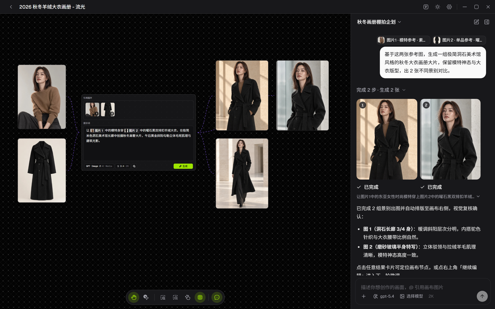
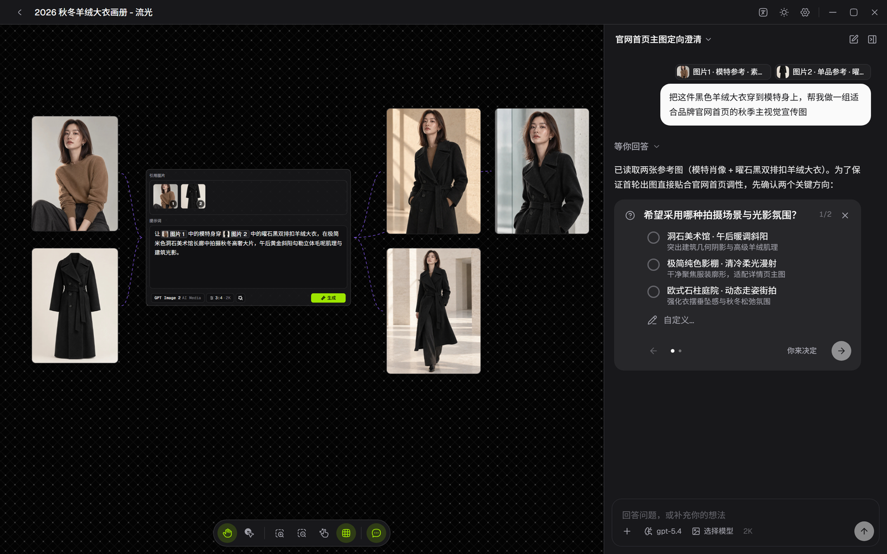
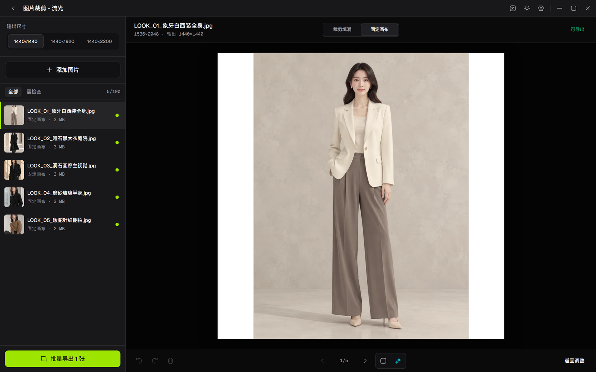
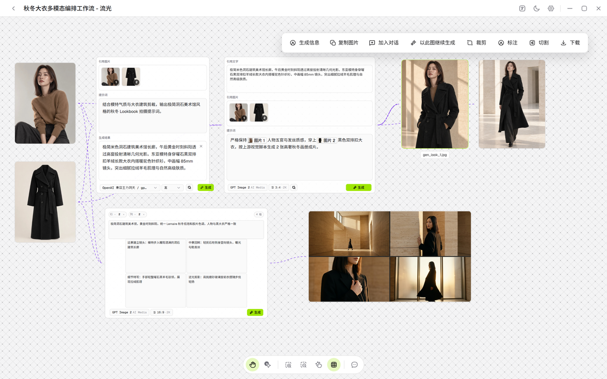
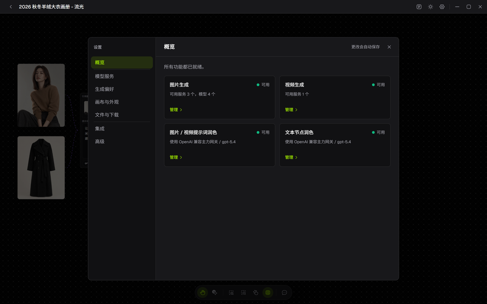
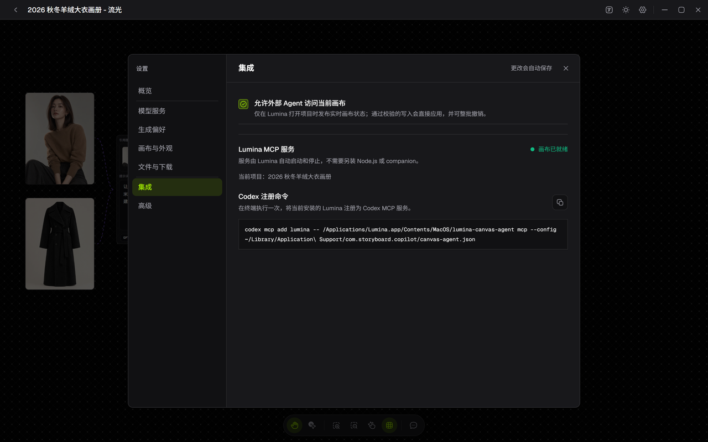

<div align="center">
  
  <h1>Lumina</h1>
  <p><strong>A desktop node-canvas studio for AI visual creation</strong></p>
  <p>Combining an infinite node canvas, built-in &amp; external MCP canvas agents, multi-reference image &amp; storyboard workflows, a batch fixed-canvas retouching workbench, and Seedance multimodal video pipelines.</p>

  <p>
    <a href="./README.md">简体中文</a> · <strong>English</strong>
  </p>

  <p>
    <a href="https://github.com/mailwmj/Lumina/releases/latest">
      
    </a>
    
    
    <a href="./LICENSE">
      
    </a>
  </p>

  <p>
    <a href="https://github.com/mailwmj/Lumina/releases/latest"><b>Download</b></a> ·
    <a href="#features--interface-tour">Features &amp; UI</a> ·
    <a href="#dual-themes--local-workspace">Dual Themes</a> ·
    <a href="#external-agent-integration-mcp">External Agent MCP</a> ·
    <a href="#download--quick-start">Quick Start</a> ·
    <a href="#local-development--extending">Development</a>
  </p>

  <br />

  
  <br />
  <sub>Real workspace capture: multi-reference image generation on the infinite canvas + docked built-in Agent visual review &amp; auto-layout (UI shown in Simplified Chinese; full English UI built in)</sub>
</div>

---

## Highlights at a Glance

<table>
  <tr>
    <td width="50%" valign="top">
      <h3>🧩 Infinite Node Canvas Orchestration</h3>
      Wire reference media, multimodal text reasoning, AI image generation, and <code>N × M</code> storyboards on a single persistent graph. Every output preserves full provenance, parameters, and one-click upstream restore.
    </td>
    <td width="50%" valign="top">
      <h3>🤖 Two-Way Canvas &amp; Agent Collaboration</h3>
      Dock the <strong>built-in Canvas Agent</strong> beside your graph for explicit <code>@</code> image references, interactive clarification cards, and visual QA—or connect external MCP agents like Codex through Lumina's bundled native <strong>MCP companion</strong>.
    </td>
  </tr>
  <tr>
    <td width="50%" valign="top">
      <h3>✂️ Production Batch Crop &amp; AI Fill Workbench</h3>
      Process up to 100 e-commerce or lookbook photos per batch with per-image <em>Crop to Fill</em> vs. <em>Fixed Canvas</em> modes, preserving full-body framing via directional Region Stretch and parallel background AI Fill.
    </td>
    <td width="50%" valign="top">
      <h3>🔒 Native Desktop Speed + Local-First BYOK</h3>
      Built with Tauri 2, Rust, and SQLite (WAL). All projects, history stacks, and API keys stay locally on your machine while connecting freely to OpenAI Images, Gemini Native, and Seedance endpoints.
    </td>
  </tr>
</table>

---

## Why Lumina?

Most web-based AI tools trap visual production inside a linear chat thread—references get re-uploaded repeatedly, prompts are hard to reuse, and variations vanish as soon as you scroll. **Lumina** moves the entire end-to-end visual workflow onto a native desktop canvas:

| Dimension | Linear Web Chat AI Tools | Lumina Desktop Node Studio |
| --- | --- | --- |
| **Asset &amp; Version Management** | Flat chat history where references and outputs blur together | **Visual node graph** keeping references, prompt scripts, and output batches side by side with clear provenance |
| **Multi-Image Reference &amp; Reuse** | Re-upload references and copy-paste prompts every turn | **Ordered references (`Image 1`, `Image 2`, …) + upstream text chaining**, plus one-click **Restore to source** |
| **Ambiguous Briefs &amp; Agent Safety** | Blindly burns credits on guesses with no structured rollback | **Interactive clarification cards + visual self-review**; external MCP edits run atomically with **one-step batch Undo** |
| **Concept to Commercial Delivery** | Requires bouncing to Photoshop for cropping, extending, and resizing | **In-canvas Crop / Annotate / Split + dedicated Batch Fixed Canvas workbench** (Region Stretch + parallel AI Fill) |
| **Data Ownership &amp; Cost Control** | Locked to a single cloud vendor and subscription tier | **Local SQLite (WAL) auto-persistence + Bring Your Own Key (BYOK)** across your preferred providers and gateways |

---

## Features & Interface Tour

### 1. Infinite Node Canvas & Multimodal Orchestration

A compact, high-density desktop canvas engineered for visual production: drag-and-drop node creation, typed connection validation, multi-select batch connect, spline / orthogonal / smart-avoidance edge routing, grid snapping, minimap, and full batch undo/redo.

<div align="center">
  
</div>

- **Multi-Reference Image Generation &amp; Batch Output**: Wire multiple reference images in explicit order (`Image 1`, `Image 2`, …) with inline reference pills inside prompts; configure `0.5K / 1K / 2K / 4K` resolution tiers and `1 / 2 / 4` batch outputs with automatic stacked layout; inspect full generation records (**Restore to source**) and recover gracefully from network drops via manual **Re-query task** without double-charging.
- **Storyboard Grid Generation &amp; One-Click Split**: Author `N × M` storyboard grids with global style direction, cell vs. overall aspect ratio modes, consistency toggles, and split any generated grid into individual editable frames.
- **First-Class Text Nodes &amp; Independent Prompt Polishing**: Chain upstream text and up to **10 reference images** into a Text Generation node with configurable reasoning effort (`none` to `max`). Configure separate prompt-polishing models and templates for media nodes vs. text nodes.
- **Non-Destructive In-Canvas Image Tools**: Select any image node to access **Crop**, **Annotate**, **Split Storyboard**, **Continue from Image**, and a full-screen **Image Viewer** from the floating toolbar—outputs always spawn as new downstream nodes without overwriting originals.

---

### 2. Built-in Canvas Agent Panel

Expand the resizable Agent panel on the right of any canvas to turn rough creative briefs into clarified, visually reviewed iterations directly on your graph.

<div align="center">
  
</div>

- **Explicit Canvas Context**: Attach canvas images intentionally using `@`, the node toolbar's **Add to chat**, or drag-and-drop / clipboard paste. Unreferenced canvas nodes are never silently leaked to the model.
- **Interactive Clarification Cards**: When lighting, framing, or visual direction is underspecified, the Agent pauses with structured multi-step question cards—select an option, add custom notes, click **You decide** to delegate, reply directly in chat, or cancel without mutating the canvas.
- **Visual Self-Review &amp; Auto-Layout**: With vision- and tool-capable models, the Agent inspects generated outputs and refines details automatically. Generations stack cleanly in rows per conversation while the viewport pans to reveal new results.
- **Multi-Thread Persistence &amp; Traceability**: Maintain multiple conversations per project with per-thread chat model, image model, resolution, and draft memory. Click **View conversation** on any Agent-created canvas node to jump straight back to its originating turn.

---

### 3. Batch Image Crop & Fixed Canvas Workbench

Accessible directly from the home screen, purpose-built for apparel photography, e-commerce hero assets, and lookbook retouching workflows.

<div align="center">
  
</div>

- **High-Volume Standardized Delivery**: Import up to **100 images** per batch (JPG / JPEG / PNG) with e-commerce preset dimensions (`1440×1440`, `1440×1920`, `1440×2200`), exporting lossless-quality JPGs without overwriting source files.
- **Per-Image Dual Composition Modes**: Switch every image independently between **Crop to Fill** and **Fixed Canvas** while preserving separate drafts—convert vertical full-body portraits into `1:1` square frames without cropping heads or shoes.
- **Directional Region Stretch + Parallel Background AI Fill**:
  - **Region Stretch**: Drag a selection strip over clean studio backdrops and pull directional handles to extend seamlessly into blank margins, supporting multiple stretch passes with independent undo/redo.
  - **AI Fill**: Send complex or textured backgrounds to a configured image-editing model for natural outpainting. Shows model and resolution confirmation upfront, runs jobs **in parallel in the background** while you move on to the next image, and exports mixed-mode batches together.

---

### 4. Seedance Multimodal AI Video Workflow

Lumina natively integrates Volcengine Seedance video pipelines on the same canvas so you can move directly from reference images and storyboards into motion once a Video API key is configured:

| Capability | Seedance 2.0 / 2.0 Fast | Seedance 1.5 Pro |
| --- | --- | --- |
| **Input Orchestration** | **Multimodal mode** (up to 9 reference images + 3 reference videos + 3 reference audio clips + upstream text) &amp; **First / Last Frame mode** | **Single Image-to-Video** &amp; **First / Last Frame mode** (with drag-to-reorder handles) |
| **Preview &amp; Cost Control** | **Draft Mode** for low-cost motion &amp; pacing validation, then one-click promotion to final render | Standard production rendering with safe disconnect re-querying |
| **Cinematic Controls** | Camera movement presets (push, pull, pan, tilt, orbit, handheld), shot size, angle, speed, audio output &amp; web search | Camera presets, duration/aspect ratio controls &amp; customizable video prompt polish templates |

---

## Dual Themes & Local Workspace

### 1. Dark & Light Themes + Custom Accent Color

Ships with full Dark / Light themes, built-in Simplified Chinese / English localization, and customizable accent colors with automatic contrast-safe foreground calculation:

<div align="center">
  <table>
    <tr>
      <td width="50%" align="center">
        
        <br />
        <sub><b>Dark Theme</b>: low-glare studio backdrop keeping color and lighting accuracy front and center</sub>
      </td>
      <td width="50%" align="center">
        
        <br />
        <sub><b>Light Theme</b>: crisp high-contrast grid and clean surface hierarchy for daylight workflows</sub>
      </td>
    </tr>
  </table>
</div>

### 2. Local Multi-Project Manager & Settings Overview

<div align="center">
  <table>
    <tr>
      <td width="50%" align="center">
        
        <br />
        <sub><b>Local Project Manager</b>: instant search, multi-field sorting, node counts &amp; SQLite (WAL) persistence</sub>
      </td>
      <td width="50%" align="center">
        
        <br />
        <sub><b>Unified Settings Center</b>: at-a-glance readiness across image, video, and prompt-polishing services</sub>
      </td>
    </tr>
  </table>
</div>

- **Local-First Ownership**: Every project graph, undo stack, Agent thread, and generated asset persists automatically to local SQLite (WAL) and dedicated project folders. Configure up to 8 preset download directories for one-click export from any node toolbar.

---

## External Agent Integration (MCP)

Lumina bundles a standalone native MCP companion (`lumina-canvas-agent`) managed automatically by the desktop app. **End users do not need the source repository, Node.js, or Bun** to connect Codex or any standard MCP client to the active canvas.

```text
Codex / MCP Client ──(stdio MCP)──▶ lumina-canvas-agent ──(127.0.0.1 + Token)──▶ Live Lumina Canvas
```

<div align="center">
   Integrations: enable external Agent MCP access and copy the Codex registration command" />
</div>

**Connect Codex in 3 steps:**

1. Open **Settings > Integrations** in Lumina and enable **Allow external Agents to access the active canvas**.
2. Copy the auto-generated registration command and run it once in your terminal:
   ```bash
   codex mcp add lumina -- /path/to/lumina-canvas-agent mcp --config /path/to/canvas-agent.json
   ```
3. Start a new Codex session to discover Lumina's canvas tools (batch reference import, create/update/connect nodes, parallel image generation, progress long-polling, and compressed visual previews).

**Security &amp; Safety Guarantees:**
- Binds strictly to numeric loopback `127.0.0.1` with a high-entropy owner-local bearer token; API keys, local filesystem paths, and raw SQLite snapshots are never exposed.
- All writes pass an operation whitelist, active-project guard, and canvas revision check as an atomic `CanvasChangeSet`—**a single `Ctrl/Cmd + Z` reverts the entire external batch**.

> See [External Agent MCP Documentation](./docs/agents/external-agent-mcp.md) for the full tool workflow, protocol specification, and dev-mode setup.

---

## Download & Quick Start

### 1. Download the Desktop App

Grab the latest installer from [GitHub Releases](https://github.com/mailwmj/Lumina/releases/latest):

| Platform | Installer | Notes |
| --- | --- | --- |
| **macOS** (Apple Silicon &amp; Intel) | `Lumina_<version>_universal.dmg` | Universal Binary with bundled native MCP companion |
| **Windows** (x64) | `Lumina_<version>_x64-setup.exe` | NSIS installer; if first launch fails, install the [WebView2 Runtime](https://developer.microsoft.com/en-us/microsoft-edge/webview2#download) |

### 2. Start Creating in 3 Steps

1. **Configure Model Services**: Open **Settings > Model services** from the title bar and add your Image, Text, or Video APIs (use **Fetch models** and **Test connection** to verify immediately).
2. **Verify Readiness**: Open **Settings > Overview** to confirm Image generation and Prompt polishing show green **Ready** badges.
3. **Start Creating**: Click **New Project** to enter the infinite node canvas (double-click or right-click to add nodes, or toggle the docked Agent panel), or click **Image Crop** for the batch fixed-canvas workbench.

### 3. Supported BYOK Model Protocols

Lumina follows an open **BYOK (Bring Your Own Key)** architecture so you can connect official APIs, internal gateways, or compatible third-party services:

| Capability | Supported Protocols / Models | Highlights |
| --- | --- | --- |
| **Image Generation &amp; Editing** | OpenAI Images compatible (`/v1/images/generations`, `/v1/images/edits`), Gemini Native (`/v1beta/models/<model>:generateContent`), and custom compatible image gateways | Multiple concurrent providers, model catalog discovery, manual model IDs &amp; custom aspect/resolution tiers |
| **Text Nodes / Built-in Agent / Prompt Polish** | OpenAI-compatible Chat Completions text &amp; multimodal APIs | Model discovery, connection testing, vision &amp; tool-calling probes, configurable reasoning effort (`none`–`max`) |
| **Video Generation** | Volcengine Seedance-compatible video endpoints (Seedance 2.0 / 2.0 Fast / Seedance 1.5 Pro) | Multimodal references, first/last frame mode, draft mode &amp; per-provider polish templates |

---

## Local Development & Extending

### Tech Stack

| Layer | Technologies |
| --- | --- |
| **Frontend** | React 18 · TypeScript · Zustand · `@xyflow/react` · TailwindCSS · Konva · Motion · Vercel AI SDK |
| **Desktop &amp; Backend** | Tauri 2 · Rust |
| **Persistence** | SQLite (`rusqlite`, WAL mode) |
| **External Agent Bridge** | TypeScript + Bun (compiled standalone `lumina-canvas-agent` sidecar) |
| **Internationalization** | `react-i18next` + `i18next` (Simplified Chinese &amp; English) |

### Prerequisites & Quick Run

Requires **Node.js 20+** and **Rust stable** (with platform [Tauri 2 prerequisites](https://v2.tauri.app/start/prerequisites/)). **Bun 1.3+** is only required when packaging the bundled `lumina-canvas-agent` desktop sidecar.

```bash
# 1. Install frontend and Canvas Agent dependencies
npm install
npm install --prefix canvas-agent

# 2. Launch the full Tauri desktop app in dev mode (recommended)
npm run tauri dev

# Or run the Vite frontend dev server only
npm run dev
```

<details>
<summary><strong>Verification, Tests &amp; Packaging Commands</strong></summary>

```bash
# TypeScript type check
npx tsc --noEmit

# Unit tests (frontend & Canvas Agent)
npx vitest run
npm run canvas-agent:test

# Rust backend check
cd src-tauri && cargo check

# Production frontend build
npm run build

# Build desktop installers (macOS .dmg / Windows .exe)
npm run tauri build
```

</details>

<details>
<summary><strong>Core Project Structure</strong></summary>

```text
Lumina/
├── src/
│   ├── features/
│   │   ├── canvas/            # Infinite node canvas (nodes, edges, tool editors, model registry)
│   │   ├── agent/             # Built-in Canvas Agent panel, multi-thread persistence & tools
│   │   ├── canvas-agent/      # Frontend bridge for external MCP agent access
│   │   ├── batch-image-crop/  # Batch image crop, fixed canvas, region stretch & AI fill workbench
│   │   ├── project/           # Local multi-project home manager
│   │   └── settings/          # Health overview, model services, preferences, themes & MCP integration
│   ├── stores/                # Zustand state stores & dual-channel debounced persistence
│   ├── commands/              # Frontend-to-Tauri Rust command bindings
│   └── i18n/                  # Bilingual i18n setup & zh/en locale bundles
├── canvas-agent/              # External Agent MCP companion (stdio MCP + loopback HTTP)
├── src-tauri/                 # Tauri 2 + Rust backend (AI providers, SQLite, media & TOS storage)
└── docs/                      # ADRs, extension guides, product specs & release notes
```

</details>

### Further Documentation

- [External Agent MCP Guide](./docs/agents/external-agent-mcp.md)
- [Provider &amp; Model Extension Guide (ZH)](./docs/development-guides/provider-and-model-extension.md)
- [TOS Media Storage Setup (ZH)](./docs/development-guides/tos-media-storage.md) (for multimodal video reference uploads)
- [Canvas Agent Domain Glossary (ZH)](./CONTEXT.md)
- [Visual Design System &amp; Tokens (ZH)](./docs/product/lumina-visual-design-system.md)
- [Canvas Node Interaction Guide (ZH)](./docs/product/canvas-node-product-interaction-guide.md)
- [Release Notes](./docs/releases/)

---

## License

Released under the [MIT License](./LICENSE).
