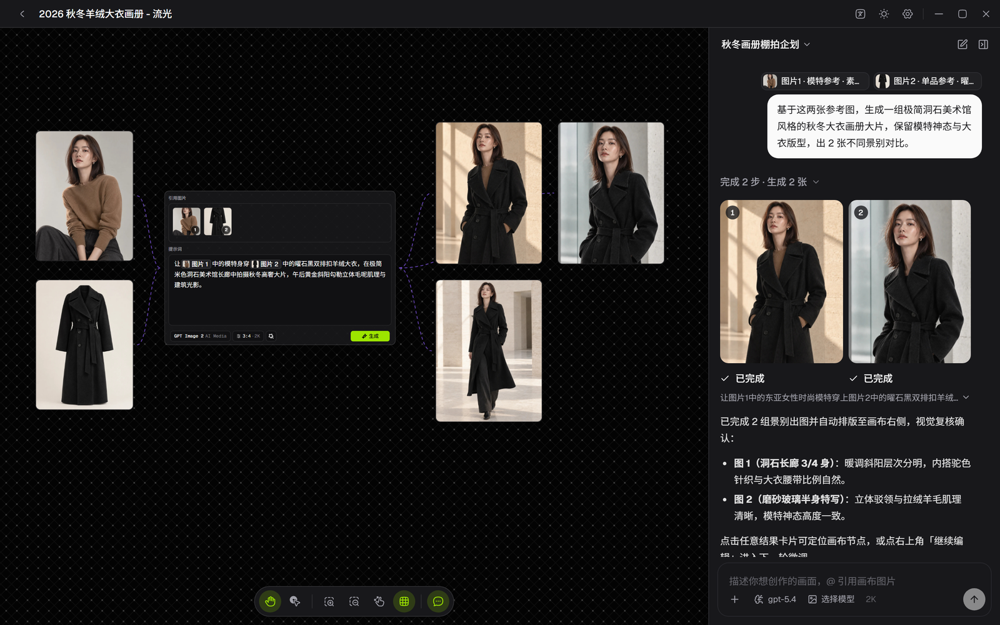
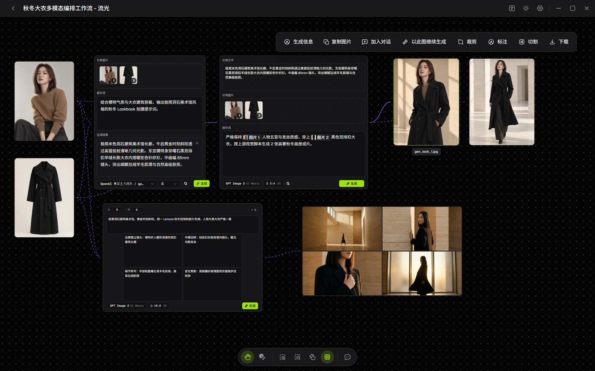
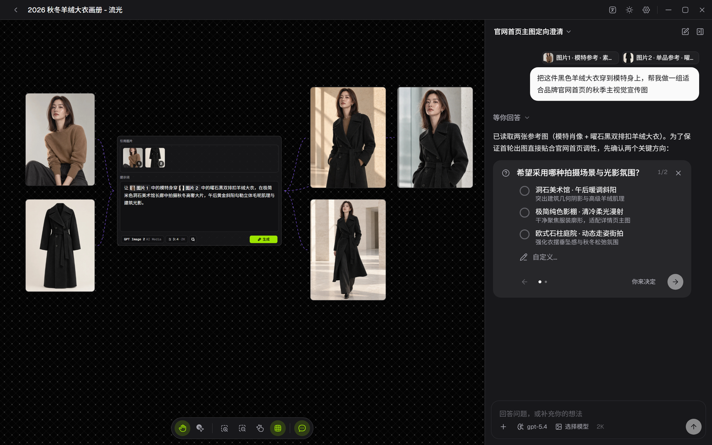
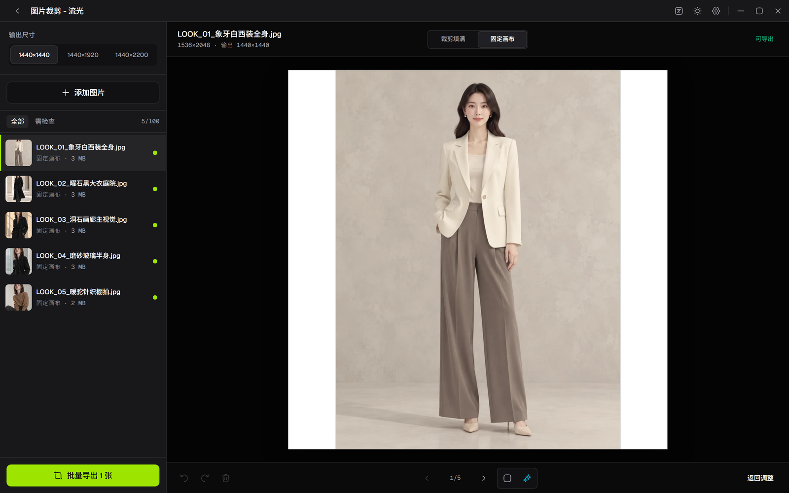

<div align="center">
  
  <h1>Lumina · 流光</h1>
  <p><strong>面向创作者的桌面级 AI 视觉节点画布工作台</strong></p>
  <p>集无限节点画布、内置与外部 AI Agent、多模态生图与分镜、Seedance 视频生成，以及批量固定画布修图于一体。</p>

  <p>
    <strong>简体中文</strong> · <a href="./README.en.md">English</a>
  </p>

  <p>
    <a href="https://github.com/mailwmj/Lumina/releases/latest">
      
    </a>
    
    
    <a href="./LICENSE">
      
    </a>
  </p>

  <p>
    <a href="https://github.com/mailwmj/Lumina/releases/latest">立即下载</a> ·
    <a href="#核心功能与界面一览">功能与界面</a> ·
    <a href="#外部-agent-接入mcp">外部 Agent MCP</a> ·
    <a href="#下载与快速上手">快速上手</a> ·
    <a href="#本地开发与扩展">开发指南</a>
  </p>

  <br />

  
</div>

---

## 为什么选择 Lumina？

传统的网页端 AI 工具往往把创作困在单条对话框里：素材难管理、提示词难复用、多版本结果一闪而过。**Lumina（流光）** 将整个视觉创作链路搬到原生桌面端的**无限节点画布**上：

- **可视化节点工作流，告别一次性抽卡**：把参考素材、文本推理、图片生成、分镜拆解与视频创作串联在同一张画布上，每张结果都可追溯来源、查看完整生成参数并一键回填上游继续迭代。
- **画布与 Agent 双向协同**：既可以在画布右侧直接呼出**内置画布 Agent** 对话式澄清需求、看图自检并自动排版出图，也能通过内置 **MCP 服务**让 Codex 等外部 Agent 直接编排当前画布，且所有操作支持**整批一键撤销**。
- **从概念发散到商业交付一站打通**：内置裁剪、标注、分镜切割等画布工具，同时提供面向电商与服装摄影后期的**批量图片裁剪与固定画布工作台**（支持区域拉伸与 AI 补全空白）。
- **原生桌面体验 + BYOK 开放模型生态**：基于 Tauri 2 + Rust + SQLite（WAL）打造，项目与 API 密钥完全保存在本地；自由接入 OpenAI Images 兼容、Gemini 原生、OpenAI 兼容文本及 Seedance 视频协议服务。

---

## 核心功能与界面一览

### 1. 无限节点画布与多模态编排

以画布为中心的紧凑工具化界面，支持拖拽创建节点、类型校验连线、多选批量连接、曲线/直角/智能避让连线样式、网格吸附、小地图与整批撤销/重做，让复杂多步创作清晰可控。

<div align="center">
  
</div>

- **AI 生图与图生图**：支持多参考图有序引用（`图片 1`、`图片 2`…）、`0.5K / 1K / 2K / 4K` 分辨率、单次 `1 / 2 / 4` 张批量出图与自动排版；提供生成记录面板（一键「填回上游节点」）以及网络异常自动恢复、不重复计费的手动「重新查询原任务」。
- **AI 分镜生成与切割**：支持自定义 `N × M` 分镜网格、全局画风提示词、单格比/整体比切换、风格一致与空分镜自动推测；生成的分镜图可一键切割为独立分镜格继续细化或导出。
- **文本生成节点 & 独立提示词润色**：文本节点作为一等公民参与工作流，支持串联上游文本与最多 10 张参考图，并可按需设置推理思考等级（`none` 至 `max`）；图片/分镜/视频与文本节点分别拥有独立的提示词润色模型与自定义模板。
- **内置画布图像工具**：任意图片节点可直接调用**裁剪（Crop）**、**标注（Annotate）**、**切割（Split）**编辑器及全屏看图器，处理结果自动生成新节点接入下游。

---

### 2. 内置画布 Agent 协作面板

在画布右侧随时展开内置 Agent，把「想法描述 → 需求澄清 → 撰写提示词 → 批量出图 → 视觉复核 → 局部修改」变成流畅的人机协作。

<div align="center">
  
</div>

- **显式画布上下文引用**：通过 `@` 触发选择器、节点工具条「加入对话」，或直接拖拽/粘贴图片到输入框，按顺序精准指定参考图，未引用的画布内容不会隐式泄露给模型。
- **交互式澄清卡片**：当构图、风格或主体不明确时，Agent 会发出结构化提问卡片，支持点选、自定义输入、「你来决定」委托或在聊天框直接回复续跑。
- **视觉自检与自动排版**：搭配支持视觉与工具调用的模型，Agent 可主动查看生成结果并迭代修正；同一会话的多次生成按行整齐堆叠在画布上，镜头自动平移展示新结果。
- **多会话持久化与来源溯源**：单项目支持多会话切换，独立记住各会话的对话模型、生图模型、分辨率与草稿；点击画布上 Agent 生成的结果节点，可一键「查看对话」跳回对应消息。

---

### 3. Seedance 多模态 AI 视频工作流

原生适配火山引擎 Seedance 系列视频生成能力，将分镜与静态素材无缝推进到动态成片。

<div align="center">
  
</div>

- **多版本模型支持**：支持 **Seedance 2.0 / 2.0 Fast** 与 **Seedance 1.5 Pro**；支持先用**样片模式（Draft）**低成本验证动态效果，满意后一键升级生成正式视频。
- **双输入模式灵活切换**：
  - **全能参考模式**：支持同时连接最多 **9 张参考图 + 3 段参考视频 + 3 段参考音频**，并结合上游文本节点驱动画面与动作。
  - **首尾帧模式**：精确绑定首帧与尾帧图片，支持拖拽调整顺序。
- **专业运镜与音频控制**：内置镜头类型（推、拉、摇、移、环绕、手持等）、景别、拍摄角度、运镜速度预设，支持输出声音、联网搜索以及任务中断后的安全重查。

---

### 4. 批量图片裁剪与固定画布工作台

从首页一键进入独立的批量图片适配工作台，专为电商主图、服装模特图等高频标准化尺寸输出场景打造。

<div align="center">
  
</div>

- **大批量标准化输出**：单批最多导入 **100 张**（JPG / JPEG / PNG），预设电商常用尺寸（`1440 × 1440`、`1440 × 1920`、`1440 × 2200`），统一导出无损质量 JPG 且不覆盖原图。
- **单图独立双构图模式**：每张图可单独在**裁剪填满**与**固定画布**之间切换，并保留各自调整草稿；竖版全身图转方图时无需切掉人物头脚，可自由等比缩放与移动构图。
- **区域条带拉伸 + AI 补全空白**：
  - **区域拉伸**：简单纯色/规则背景只需框选画面并拖动方向手柄即可向空白处延展，支持多个拉伸区域与独立撤销/重做。
  - **AI 补全**：复杂实景背景可将完整固定画布交由已配置的图片编辑模型自然延展空白；提交前展示清晰度与费用提示，支持**后台并行生成**，点「处理下一张」即可继续编辑后续图片，最终整批混合导出。

---

### 5. 本地多项目管理、开放模型设置与明暗双主题

<div align="center">
  <table>
    <tr>
      <td width="50%" align="center">
        
        <br />
        <sub><b>本地多项目管理</b>：搜索、排序、节点计数与 SQLite 自动持久化</sub>
      </td>
      <td width="50%" align="center">
        
        <br />
        <sub><b>设置中心</b>：服务健康概览、多协议模型管理、外部 MCP 与主题定制</sub>
      </td>
    </tr>
  </table>
</div>

- **本地数据掌控**：所有项目状态、画布历史与 Agent 会话通过 SQLite（WAL）自动落盘，无云端锁死风险；支持自定义下载预设目录，节点工具条一键保存。
- **中英双语 & 视觉定制**：完整内置简体中文 / English 界面、深色 / 浅色双主题以及可自定义强调色（运行时自动计算文字对比度）。

---

## 外部 Agent 接入（MCP）

Lumina 桌面安装包内置独立的本机 MCP Companion（`lumina-canvas-agent`），随应用自动启停，**终端用户无需安装源码、Node.js 或 Bun**，即可让 Codex 等标准 MCP 客户端安全读写当前打开的画布。

```text
Codex / 标准 MCP 客户端 ──(stdio MCP)──▶ lumina-canvas-agent ──(127.0.0.1 + Token)──▶ Lumina 实时画布
```

**三步接入 Codex：**

1. 打开 Lumina 的 **设置 > 集成**，开启「允许外部 Agent 访问当前画布」。
2. 复制页面自动生成的注册命令，在终端执行一次：
   ```bash
   codex mcp add lumina -- /path/to/lumina-canvas-agent mcp ...
   ```
3. 新建 Codex 任务即可发现并使用画布工具（导入参考图、创建/更新/连线节点、运行生图、等待进度与读取压缩预览）。

**安全与可控保障：**
- 仅监听本机回环地址 `127.0.0.1`，全部请求强制高熵 Bearer Token 鉴权，绝不暴露 API 密钥、本地路径或原图数据。
- 所有写操作均经过操作白名单、活动项目与画布版本号校验，作为原子变更集（`CanvasChangeSet`）执行，**画布按一次撤销即可完整回退整批操作**。

> 详细协议、工具工作流与开发态接入方式请参阅 [外部 Agent MCP 文档](./docs/agents/external-agent-mcp.md)。

---

## 下载与快速上手

### 1. 下载桌面客户端

前往 [GitHub Releases](https://github.com/mailwmj/Lumina/releases/latest) 下载对应平台的最新安装包：

| 平台 | 安装包 | 说明 |
| --- | --- | --- |
| **macOS** (Apple Silicon & Intel) | `Lumina_<version>_universal.dmg` | 通用二进制（Universal Binary），内置原生 MCP Companion |
| **Windows** (x64) | `Lumina_<version>_x64-setup.exe` | NSIS 安装包；若启动报错请先安装 [WebView2 运行时](https://developer.microsoft.com/zh-cn/Microsoft-edge/webview2#download) |

### 2. 首次配置（3 步开始创作）

1. **配置模型服务**：点击顶部标题栏打开 **设置 > 模型服务**，按需添加图片、文本或视频 API（填写 Base URL 与 API Key 后可一键「获取模型」与「测试连接」）。
2. **确认就绪状态**：在 **设置 > 概览** 中查看各项能力（图片生成、视频生成、提示词润色）的就绪状态，如有缺失可直接跳转补齐。
3. **开始创作**：返回首页点击「新建项目」进入无限节点画布（双击或右键画布添加节点），或点击「图片裁剪」进入批量裁剪工作台。

### 3. 支持的模型服务与协议

Lumina 采用 **BYOK（自带密钥）** 架构，你可以自由对接任意兼容协议的官方接口、企业网关或第三方模型服务：

| 能力模块 | 支持协议 / 模型类型 | 核心特性 |
| --- | --- | --- |
| **图片生成与编辑** | OpenAI Images 兼容（`/v1/images/generations`、`/v1/images/edits`）、Gemini 原生协议（`/v1beta/models/<model>:generateContent`）及其他兼容自定义图片服务 | 支持自定义 Base URL、多服务商并存、模型列表自动发现与手动添加模型 ID |
| **文本节点 / 内置 Agent / 提示词润色** | OpenAI 兼容 Chat Completions 文本与多模态 API | 支持自动发现与连接测试、视觉看图能力检测、工具调用检测与可配思考等级 |
| **视频生成** | 火山引擎 Seedance 协议兼容服务（Seedance 2.0 / 2.0 Fast / Seedance 1.5 Pro） | 支持多模态全能参考、首尾帧、样片模式及自定义视频提示词润色模板 |

---

## 本地开发与扩展

### 技术栈

| 层级 | 技术选型 |
| --- | --- |
| **前端界面** | React 18 · TypeScript · Zustand · `@xyflow/react` · TailwindCSS · Motion · Vercel AI SDK |
| **桌面容器与后端** | Tauri 2 · Rust |
| **数据存储** | SQLite（`rusqlite`，WAL 模式） |
| **外部 Agent 桥接** | TypeScript + Bun（独立编译为 `lumina-canvas-agent` sidecar） |
| **国际化** | `react-i18next` + `i18next`（内置简体中文 / English） |

### 环境要求

- **Node.js** 20+ 与 **npm** 10+
- **Rust** stable（含 Cargo）与对应平台的 [Tauri 2 构建依赖](https://v2.tauri.app/start/prerequisites/)
- **Bun** 1.3+（仅在打包桌面安装包内的 `lumina-canvas-agent` 可执行文件时需要）

### 运行与构建

```bash
# 1. 安装前端与 Canvas Agent 依赖
npm install
npm install --prefix canvas-agent

# 2. 启动 Tauri 桌面联调（推荐）
npm run tauri dev

# 或仅启动前端开发服务器
npm run dev
```

<details>
<summary><strong>常用检查与打包命令</strong></summary>

```bash
# TypeScript 类型检查
npx tsc --noEmit

# 运行单元测试（前端与 Canvas Agent）
npx vitest run
npm run canvas-agent:test

# Rust 后端检查
cd src-tauri && cargo check

# 前端生产构建
npm run build

# 构建桌面安装包（macOS .dmg / Windows .exe）
npm run tauri build
```

</details>

<details>
<summary><strong>核心目录结构</strong></summary>

```text
Lumina/
├── src/
│   ├── features/
│   │   ├── canvas/            # 无限节点画布（节点、连线、工具编辑器、模型注册表）
│   │   ├── agent/             # 右侧内置画布 Agent 面板、会话与工具调用
│   │   ├── canvas-agent/      # 前端与外部 Agent MCP 的受控桥接层
│   │   ├── batch-image-crop/  # 批量图片裁剪、固定画布、区域拉伸与 AI 补全工作台
│   │   ├── project/           # 本地多项目管理首页
│   │   └── settings/          # 模型服务、生成偏好、外观与集成设置
│   ├── stores/                # Zustand 全局状态与自动持久化策略
│   ├── commands/              # 前端到 Tauri/Rust 的命令桥接
│   └── i18n/                  # 中英双语国际化入口与语言包
├── canvas-agent/              # 外部 Agent MCP Companion 源码（stdio MCP + loopback HTTP）
├── src-tauri/                 # Tauri 2 + Rust 后端（AI 代理、SQLite 持久化、媒体处理与 TOS 存储）
└── docs/                      # 架构决策、扩展指南、产品规范与版本发布日志
```

</details>

### 延伸文档导航

- [外部 Agent MCP 接入与安全规范](./docs/agents/external-agent-mcp.md)
- [供应商与模型扩展指南](./docs/development-guides/provider-and-model-extension.md)
- [TOS 媒体存储配置（视频多模态参考上传）](./docs/development-guides/tos-media-storage.md)
- [画布 Agent 领域上下文与术语约定](./CONTEXT.md)
- [视觉规范与设计 Token](./docs/product/lumina-visual-design-system.md)
- [画布节点交互规范](./docs/product/canvas-node-product-interaction-guide.md)
- [历史版本更新日志](./docs/releases/)

---

## 开源协议

本项目基于 [MIT License](./LICENSE) 开源。
