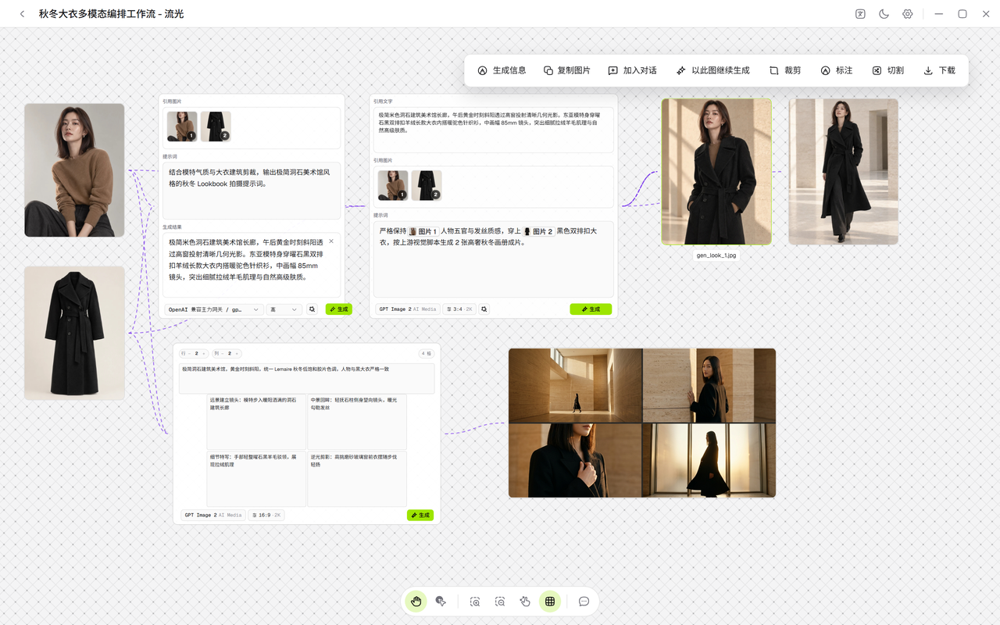
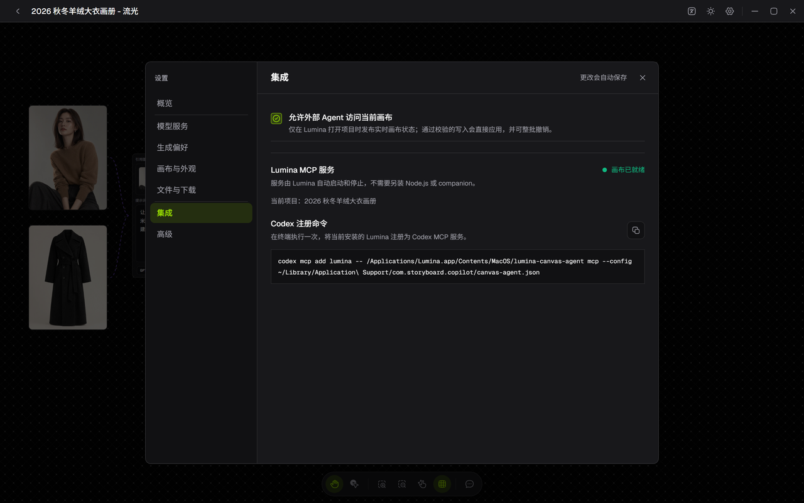

<div align="center">
  
  <h1>Lumina · 流光</h1>
  <p><strong>面向视觉创作者的桌面级 AI 节点画布工作台</strong></p>
  <p>集无限节点画布、内置与外部 MCP 画布 Agent、多图参考生图与分镜编排、批量固定画布修图，以及 Seedance 多模态视频工作流于一体。</p>

  <p>
    <strong>简体中文</strong> · <a href="./README.en.md">English</a>
  </p>

  <p>
    <a href="https://github.com/mailwmj/Lumina/releases/latest">
      
    </a>
    
    
    <a href="./LICENSE">
      
    </a>
  </p>

  <p>
    <a href="https://github.com/mailwmj/Lumina/releases/latest"><b>立即下载</b></a> ·
    <a href="#核心功能与界面一览">功能与界面</a> ·
    <a href="#深浅双主题与工作空间">双主题对比</a> ·
    <a href="#外部-agent-接入mcp">外部 Agent MCP</a> ·
    <a href="#下载与快速上手">快速上手</a> ·
    <a href="#本地开发与扩展">开发指南</a>
  </p>

  <br />

  
  <br />
  <sub>真实工作台截图：多参考图连线生图 + 右侧内置画布 Agent 自动出图与视觉复核</sub>
</div>

---

## 核心亮点速览

<table>
  <tr>
    <td width="50%" valign="top">
      <h3>🧩 无限节点画布编排</h3>
      将参考图、文本推理、AI 生图与 <code>N × M</code> 分镜串联在同一张画布上，所有产物可追溯来源、查看完整参数并一键回填上游继续迭代。
    </td>
    <td width="50%" valign="top">
      <h3>🤖 画布与 Agent 双向协同</h3>
      右侧随时展开<strong>内置画布 Agent</strong>，支持 <code>@</code> 引用画布图、交互式澄清卡片与视觉自检；同时内置原生 <strong>MCP 服务</strong>，让 Codex 等外部 Agent 直接编排当前画布。
    </td>
  </tr>
  <tr>
    <td width="50%" valign="top">
      <h3>✂️ 电商级批量裁剪与 AI 补全</h3>
      独立批量修图工作台支持单批 100 张标准化导出，单图自由切换「裁剪填满 / 固定画布」，竖版全身图转方图无需切头脚，内置区域拉伸与后台并行 AI 补全。
    </td>
    <td width="50%" valign="top">
      <h3>🔒 原生桌面体验 + BYOK 本地优先</h3>
      基于 Tauri 2 + Rust + SQLite（WAL）打造，项目历史、画布资产与 API 密钥完全存储在本地，自由对接 OpenAI Images、Gemini 原生与 Seedance 等多协议服务。
    </td>
  </tr>
</table>

---

## 为什么选择 Lumina？

传统的网页端 AI 工具往往把视觉创作困在单条线性对话框里：参考图反复上传、提示词难以复用、多版本结果一滚即逝。**Lumina（流光）** 把完整的商业视觉生产链路搬回原生桌面端：

| 对比维度 | 传统网页对话式 AI 工具 | Lumina（流光）桌面节点工作台 |
| --- | --- | --- |
| **素材与多版本管理** | 聊天记录线性堆叠，历史成片与参考图混杂难找 | **可视化节点图谱**，所有参考素材、中间脚本与多批成片同屏平铺、连线溯源 |
| **多图参考与提示词复用** | 每次改图重新传图、重新复制粘贴提示词 | **有序多图引用（`图片 1`、`图片 2`…）+ 上游文本串联**，支持生成记录一键「填回上游节点」 |
| **复杂需求与 AI 协作** | 需求模糊时盲目抽卡，容易答非所问且难以回退 | **内置 Agent 交互式澄清卡片 + 视觉自检**；外部 MCP 写操作原子化应用，**一键整批撤销** |
| **从创意到商业交付** | 出图后仍需切回 PS 逐张裁图、拉背景、改尺寸 | **画布内裁剪/标注/分镜切割 + 批量固定画布工作台**（区域拉伸 + 并行 AI 扩图），一站直出成片 |
| **数据主权与使用成本** | 依赖单一云端订阅，资产与项目锁定在网页平台 | **纯本地 SQLite（WAL）自动持久化 + BYOK 自带密钥**，自由切换性价比最高的模型网关 |

---

## 核心功能与界面一览

### 1. 无限节点画布与多模态编排

以高密度视觉创作为核心的紧凑桌面画布，支持拖拽建节点、类型校验连线、多选批量连接、曲线 / 直角 / 智能避让连线样式、网格吸附、小地图与整批撤销重做。

<div align="center">
  
</div>

- **多参考图 AI 生图与批量出图**：支持多张参考图按连线顺序自动编号（`图片 1`、`图片 2`…）并在提示词中内联引用；支持 `0.5K / 1K / 2K / 4K` 分辨率、单次 `1 / 2 / 4` 张批量生成与自动排版；内置生成记录面板（一键回填上游参数）及断网自动恢复、绝不重复计费的手动「重新查询原任务」。
- **AI 分镜网格与一键切割**：原生分镜节点支持自定义 `N × M` 网格、全局画风控制、单格比 / 整体比切换、角色风格一致与空分镜自动推测；成片可通过工具条一键切割为独立单帧继续细化或导出。
- **文本生成节点与独立润色体系**：文本节点作为画布一等公民，支持串联上游文本与最多 **10 张参考图**，可按需配置推理思考等级（`none` 至 `max`）；图片 / 分镜 / 视频节点与文本节点拥有各自独立的提示词润色模型与自定义模板。
- **非破坏性画布图像工具**：选中任意图片节点即可在顶部悬浮工具条呼出 **裁剪（Crop）**、**标注（Annotate）**、**切割（Split）**、**以此图继续生成** 与全屏看图器，所有处理结果自动产出新节点，永不覆盖原图。

---

### 2. 内置画布 Agent 深度协作面板

随时在画布右侧展开可调宽的内置 Agent 面板，把「模糊灵感 → 需求澄清 → 撰写提示词 → 批量出图 → 视觉复核 → 局部迭代」融为流畅的画布内人机协同。

<div align="center">
  
</div>

- **显式可控的画布引用**：通过输入框 `@` 选择器、节点工具条「加入对话」或直接拖拽 / 粘贴图片，按顺序精准指定参考图；未显式引用的画布内容绝不会隐式泄露给模型。
- **结构化交互式澄清卡片**：当场景、构图或风格尚不明确时，Agent 会主动暂停并发出多步提问卡片，支持点选推荐方案、自定义补充、点击「你来决定」委托决策，或直接在聊天框回复续跑——确认前不污染画布。
- **视觉自检与自动排版**：搭配支持视觉与工具调用的多模态模型，Agent 可主动查看生成结果并迭代修正；同一会话的多轮产出在画布上按行整齐堆叠，镜头自动平移聚焦最新结果。
- **多会话持久化与双向溯源**：单项目支持多会话切换，独立记忆各会话的对话模型、生图模型、分辨率与未发草稿；点击画布上由 Agent 产出的图片节点，可一键「查看对话」跳回对应回合。

---

### 3. 批量图片裁剪与固定画布工作台

从首页顶部一键进入独立的批量图片适配工作台，专为服装摄影、电商主图与品牌 Lookbook 等高频标准化出图场景打造。

<div align="center">
  
</div>

- **百图批量标准化导出**：单批最多导入 **100 张**（JPG / JPEG / PNG），内置电商常用目标尺寸（`1440×1440`、`1440×1920`、`1440×2200`），统一导出高质量 JPG 且绝不覆盖原始素材。
- **单图独立双构图模式**：每张图可独立切换 **裁剪填满** 与 **固定画布** 并分别保存草稿；竖版全身人像转 `1:1` 方图时无需切掉人物头脚，可自由等比缩放与微调位置。
- **区域条带拉伸 + 后台并行 AI 补全空白**：
  - **区域拉伸**：纯色或规则影棚背景只需框选条带并拖动方向手柄即可无缝延展空白区域，支持多段拉伸与独立撤销 / 重做。
  - **AI 补全**：复杂实景或肌理背景可直接交由已配置的图片编辑模型自然延展留白；提交前清晰展示模型与清晰度提示，支持**后台并行生成**，无需等待即可点下一张继续修图，最后整批混合导出。

---

### 4. Seedance 多模态 AI 视频工作流

Lumina 同时原生适配火山引擎 Seedance 系列视频生成能力，可在同一张节点画布上把静态概念图与分镜无缝推进到动态成片（配置视频 API Key 后即可在画布右键菜单直接创建）：

| 能力维度 | Seedance 2.0 / 2.0 Fast | Seedance 1.5 Pro |
| --- | --- | --- |
| **输入编排模式** | **全能参考模式**（最多串联 9 张参考图 + 3 段参考视频 + 3 段参考音频 + 上游文本）与 **首尾帧模式** | **单图生视频** 与 **首尾帧模式**（支持拖拽调整首尾顺序） |
| **成本与预览工作流** | 支持 **样片模式（Draft）** 低成本快速验证运镜与节奏，满意后一键升级正式成片 | 支持常规高质量成片生成与断线安全重查 |
| **专业导演控制** | 内置镜头类型（推/拉/摇/移/环绕/手持等）、景别、机位角度、运镜速度预设，支持输出声音与联网搜索 | 支持运镜参数预设、时长/比例配置与自定义视频提示词润色模板 |

---

## 深浅双主题与工作空间

### 1. 深 / 浅双主题与自定义强调色

完整内置深色 / 浅色双主题、简体中文 / English 双语切换与可自定义强调色（运行时自动计算安全文字对比度），白天强光与暗室修图均清晰舒适：

<div align="center">
  <table>
    <tr>
      <td width="50%" align="center">
        
        <br />
        <sub><b>深色主题（Dark）</b>：低眩光暗场设计，让摄影色彩与光影成为绝对视觉焦点</sub>
      </td>
      <td width="50%" align="center">
        
        <br />
        <sub><b>浅色主题（Light）</b>：高对比清爽网格与柔和卡片层次，日间办公清晰通透</sub>
      </td>
    </tr>
  </table>
</div>

### 2. 本地多项目管理与服务就绪概览

<div align="center">
  <table>
    <tr>
      <td width="50%" align="center">
        
        <br />
        <sub><b>本地多项目管理</b>：实时搜索、多维排序、节点计数与 SQLite（WAL）自动持久化</sub>
      </td>
      <td width="50%" align="center">
        
        <br />
        <sub><b>一站式设置中心</b>：图片 / 视频 / 文本润色就绪状态一目了然，改动即时生效</sub>
      </td>
    </tr>
  </table>
</div>

- **本地优先、自动落盘**：所有项目画布、撤销历史、Agent 多会话与生成资产均持久化至本机 SQLite（WAL）与独立项目目录；支持最多 8 个自定义快捷下载目录，节点工具条一键保存成片。

---

## 外部 Agent 接入（MCP）

Lumina 桌面安装包内置独立的原生 MCP Companion（`lumina-canvas-agent`），随应用自动启停。**终端用户无需克隆源码，也无需安装 Node.js 或 Bun**，即可让 Codex 等标准 MCP 客户端安全读写当前打开的画布。

```text
Codex / 标准 MCP 客户端 ──(stdio MCP)──▶ lumina-canvas-agent ──(127.0.0.1 + Token)──▶ Lumina 实时画布
```

<div align="center">
   集成：一键启用外部 Agent MCP 并复制 Codex 注册命令" />
</div>

**三步接入 Codex：**

1. 打开 Lumina 的 **设置 > 集成**，勾选「允许外部 Agent 访问当前画布」。
2. 点击复制页面自动生成的注册命令，在终端执行一次：
   ```bash
   codex mcp add lumina -- /path/to/lumina-canvas-agent mcp --config /path/to/canvas-agent.json
   ```
3. 新建 Codex 任务即可自动发现并调用画布工具（批量导入参考图、创建 / 更新 / 连线节点、并行运行生图、等待任务进度与读取压缩视觉预览）。

**安全与可控边界：**
- 仅监听本机回环地址 `127.0.0.1`，除基础 `/health` 外全部请求强制高熵 Bearer Token 鉴权，绝不向外暴露 API 密钥、本地文件路径或原始数据库。
- 全部写操作严格通过操作白名单、当前活动项目与画布版本号校验，作为原子变更集（`CanvasChangeSet`）执行，**在画布按一次 `Ctrl/Cmd + Z` 即可完整回退整批外部修改**。

> 完整工具协议、工作流规范与开发态调试方式请参阅 [外部 Agent MCP 文档](./docs/agents/external-agent-mcp.md)。

---

## 下载与快速上手

### 1. 下载桌面客户端

前往 [GitHub Releases](https://github.com/mailwmj/Lumina/releases/latest) 获取对应平台的最新安装包：

| 平台 | 安装包 | 说明 |
| --- | --- | --- |
| **macOS** (Apple Silicon & Intel) | `Lumina_<version>_universal.dmg` | 通用二进制（Universal Binary），内置原生 MCP Companion |
| **Windows** (x64) | `Lumina_<version>_x64-setup.exe` | NSIS 安装包；若首次启动报错请先安装 [WebView2 运行时](https://developer.microsoft.com/zh-cn/Microsoft-edge/webview2#download) |

### 2. 三步开始第一次创作

1. **配置模型服务**：点击标题栏右上角进入 **设置 > 模型服务**，添加图片、文本或视频 API（填写 Base URL 与 API Key 后可一键「获取模型」与「测试连接」）。
2. **确认能力就绪**：在 **设置 > 概览** 中确认图片生成、提示词润色等模块显示为绿色「可用」。
3. **进入工作台**：返回首页点击 **新建项目** 打开无限节点画布（双击或右键画布添加节点，右上角可随时展开内置 Agent），或点击 **图片裁剪** 进入批量固定画布工作台。

### 3. 支持的 BYOK 模型服务与协议

Lumina 采用 **BYOK（自带密钥）** 开放架构，可自由对接官方接口、自建中转或企业模型网关：

| 能力模块 | 支持协议 / 模型类型 | 核心特性 |
| --- | --- | --- |
| **图片生成与编辑** | OpenAI Images 兼容（`/v1/images/generations`、`/v1/images/edits`）、Gemini 原生协议（`/v1beta/models/<model>:generateContent`）及多自定义兼容图片网关 | 支持多服务商并存、模型目录自动发现、手动补充模型 ID 与自定义比例 / 分辨率 |
| **文本节点 / 内置 Agent / 提示词润色** | OpenAI 兼容 Chat Completions 文本与多模态 API | 自动模型发现与连接测试、视觉看图与工具调用能力探测、可配置思考等级（`none`–`max`） |
| **视频生成** | 火山引擎 Seedance 协议兼容服务（Seedance 2.0 / 2.0 Fast / Seedance 1.5 Pro） | 全能多模态参考、首尾帧、样片模式预览及自定义视频提示词润色模板 |

---

## 本地开发与扩展

### 技术栈

| 层级 | 技术选型 |
| --- | --- |
| **前端界面** | React 18 · TypeScript · Zustand · `@xyflow/react` · TailwindCSS · Konva · Motion · Vercel AI SDK |
| **桌面容器与后端** | Tauri 2 · Rust |
| **本地持久化** | SQLite（`rusqlite`，WAL 模式） |
| **外部 Agent 桥接** | TypeScript + Bun（独立编译为 `lumina-canvas-agent` sidecar） |
| **国际化** | `react-i18next` + `i18next`（内置简体中文 / English） |

### 环境要求与启动

需要 **Node.js 20+**、**Rust stable**（含 [Tauri 2 构建依赖](https://v2.tauri.app/start/prerequisites/)）；仅在打包桌面安装包内的 `lumina-canvas-agent` 可执行文件时需要 **Bun 1.3+**。

```bash
# 1. 安装前端与 Canvas Agent 依赖
npm install
npm install --prefix canvas-agent

# 2. 启动完整 Tauri 桌面联调（推荐）
npm run tauri dev

# 或仅启动前端 Vite 开发服务器
npm run dev
```

<details>
<summary><strong>常用校验、测试与打包命令</strong></summary>

```bash
# TypeScript 类型检查
npx tsc --noEmit

# 运行前端与 Canvas Agent 单元测试
npx vitest run
npm run canvas-agent:test

# Rust 后端快速检查
cd src-tauri && cargo check

# 前端生产构建
npm run build

# 构建桌面安装包（macOS .dmg / Windows .exe）
npm run tauri build
```

</details>

<details>
<summary><strong>核心目录结构</strong></summary>

```text
Lumina/
├── src/
│   ├── features/
│   │   ├── canvas/            # 无限节点画布（节点、连线、图像工具编辑器、模型注册表）
│   │   ├── agent/             # 右侧内置画布 Agent 面板、多会话持久化与工具调用
│   │   ├── canvas-agent/      # 前端与外部 Agent MCP 的受控桥接层
│   │   ├── batch-image-crop/  # 批量图片裁剪、固定画布、区域拉伸与 AI 补全工作台
│   │   ├── project/           # 本地多项目管理首页
│   │   └── settings/          # 服务健康概览、模型服务、偏好设置、双主题与 MCP 集成
│   ├── stores/                # Zustand 全局状态与双通道防抖持久化
│   ├── commands/              # 前端到 Tauri/Rust 的命令封装
│   └── i18n/                  # 中英双语国际化入口与语言包
├── canvas-agent/              # 外部 Agent MCP Companion 源码（stdio MCP + loopback HTTP）
├── src-tauri/                 # Tauri 2 + Rust 后端（AI 代理、SQLite、媒体处理与 TOS 上传）
└── docs/                      # 架构决策（ADR）、扩展指南、产品设计规范与版本更新日志
```

</details>

### 延伸文档导航

- [外部 Agent MCP 接入与安全规范](./docs/agents/external-agent-mcp.md)
- [供应商与模型扩展指南](./docs/development-guides/provider-and-model-extension.md)
- [TOS 媒体存储配置（视频多模态参考上传）](./docs/development-guides/tos-media-storage.md)
- [画布 Agent 领域上下文与术语约定](./CONTEXT.md)
- [视觉规范与设计 Token](./docs/product/lumina-visual-design-system.md)
- [画布节点交互规范](./docs/product/canvas-node-product-interaction-guide.md)
- [历史版本更新日志](./docs/releases/)

---

## 开源协议

本项目基于 [MIT License](./LICENSE) 开源。
